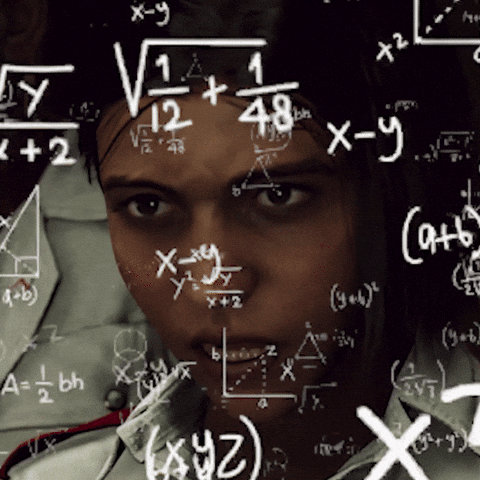
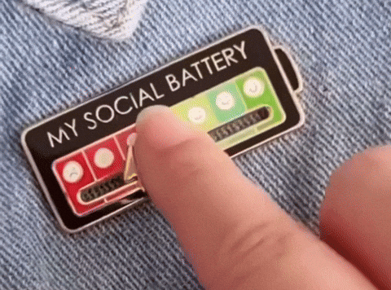

Repetition. Time.

Two concepts that, once combined, can take you to a solid level in pretty much any field. I really be believing this, so let me tell you why.

## What's this 10,000-hour thing?

Let's set the scene. The 10,000-hour rule, popularized by Malcolm Gladwell in his book *Outliers*, says it takes around 10,000 hours of deliberate, intensive practice to reach expert level in a field.

Yes, that definition is straight up copy-pasted from Google. What you gonna do about it?

But what interests me in this idea isn't really the number itself. It's what it stands for: the amount of time you put in before you realize how far you've come. The hustle, basically.

Freestyle football. Beatmaking. Code. Three fields that have nothing to do with each other, and yet the same rule applied, without me even noticing. Don't get me wrong, I don't see myself as an expert in any of them. But I managed to reach a good level in each one, and it's always the same recipe.

## Freestyle football

It all starts with Paul Pogba. The GOAT, and that's on everything.

One day, I come across a video of him with the S3 Freestyle team, pulling off an LATW, better known as the double around the world.

<iframe
  src="https://www.youtube-nocookie.com/embed/Q_uLiSaU3Tg"
  title="Paul Pogba with S3 Freestyle"
  loading="lazy"
  allow="accelerometer; clipboard-write; encrypted-media; gyroscope; picture-in-picture"
  allowFullScreen
  style={{ width: "100%", aspectRatio: "16 / 9", border: 0, borderRadius: "12px" }}
/>

Completely hooked by that crazy trick, and already pretty good with a ball (no flex), I dive into copying every stylish, impressive move I could find. I fail, I repeat, I start over. And at some point, the double around the world, which looked like an insanely hard move, became one of the easiest ones for me.

Small flex though: back then, I was the second most followed freestyler in Senegal (shout-out to Alvine Footstyle). And since I was also playing football, it made me way more comfortable on the ball during games.

## Beatmaking

The ball was one thing. But there's something else that has always been with me: music.

I'm a huge rap fan in general, whether it's US, FR, UK or SN. I've always been surrounded by it, thanks to an older brother who stayed playing heat: Weezy F. Baby aka Lil Wayne, Future, Booba, La Fouine…

And in the back of my mind, watching beatmaker videos, I always wondered how they managed to cook up bangers like that for our ears.

Then comes 2020. Lockdown, well, a partial lockdown in Senegal, with an 8pm curfew. Personally, I count it as a full lockdown, since I'm the ultimate homebody.

I reinstall FL Studio (cracked, obviously, that's half the charm), which I already had but never really used, and start following videos from Chuki Beats, Nick Mira and other US beatmakers. Little by little, I start to get the principles: laying down chord progressions and counter-melodies, sometimes following music theory (minor or major scales), sometimes with zero regard for it. Then the drums, tuning the 808s, mixing the beat and dropping it on YouTube. Yes, I'm getting technical, let me flex a little more.

The result: two YouTube channels, not very big, but still secured the bag on a few leases here and there. Since I'm humble, I'll let you judge my level for yourself:

<iframe
  src="https://www.youtube-nocookie.com/embed/a_NDKjjS0k0"
  title="One of my beats"
  loading="lazy"
  allow="accelerometer; clipboard-write; encrypted-media; gyroscope; picture-in-picture"
  allowFullScreen
  style={{ width: "100%", aspectRatio: "16 / 9", border: 0, borderRadius: "12px" }}
/>

The two channels: [@coogie27](https://www.youtube.com/@coogie27) and [@ryukabeats](https://www.youtube.com/@ryukabeats).

## Code

Now, on to the field I'm in today: shipping code. And for this one, we need to go back a bit further.

Summer break, right before middle school. I watch *The Social Network*, the movie about how Facebook was created. Honestly, a pretty boring movie, since half of it is about legal battles. But one part blew my mind: the one where Mark Zuckerberg starts coding Facebook.

Totally starstruck, I want to build my own social network too, 100% Senegalese. And as usual, straight to YouTube. I find videos from [PrimFX](https://www.youtube.com/@primfxdesign), [@nicwalle-tuto](https://www.youtube.com/@nicwalle-tuto) and [@RAFHERMEZ](https://www.youtube.com/@RAFHERMEZ), French-speaking channels, and I grind tutorials and practice, nonstop.

HTML and CSS were super easy to get. I was rebuilding Facebook pages by hand (no Claude back then, haha). Then came PHP, jQuery and Ajax. That's where I understood a bit less, but with time, I understood more and more.

And while trying to build the hardest social network Senegal ever saw, I was picking up other skills without realizing it. Like data modeling: I'd sit down with a sheet of paper and think "this data goes in that table", "is it `VARCHAR(255)` or not?", "the password has to be hashed with SHA-1"… (yes, SHA-1, don't judge me, these days it's bcrypt or Argon2). Without a care in the world, I was discovering concepts that I still use every day as a fully self-taught developer.

## Repetition. Time.

I'll talk about my journey in more detail, and more technically, in another article.

The point of this one is to show you one thing: whatever the field, if the passion is there, all it takes is the grind. Two ingredients.

Repetition. Time.
